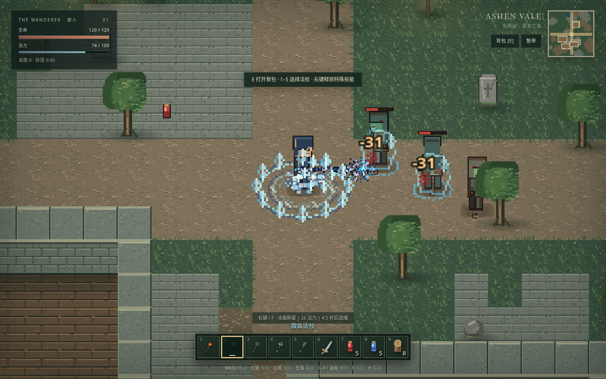
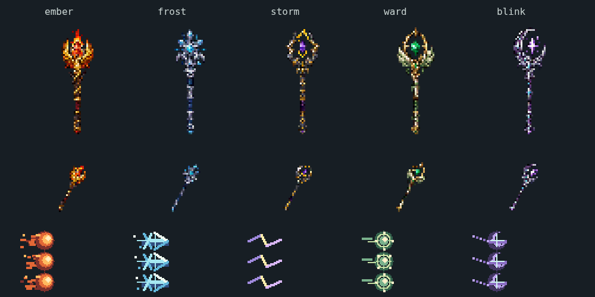

# 灰烬谷 II · Ashen Vale

一个能直接跑、能继续共创的中世纪生存游戏：**TypeScript + PixiJS 8 + 自定义 ECS**，俯视 2D，移动/朝向/贴图/动画/战斗/AI 都是完整逻辑，不是静态展示。

题材是《僵尸毁灭工程》的体验借鉴，但换成中世纪：**没有枪支**，武器是长剑与法杖，五系法杖涵盖余烬、冰霜、雷电、护盾与相位闪烁，敌人是行尸、疾行者和亡灵法师。

架构照搬 `D:/go/goengine` 的模拟/表现分层与动画方案，逐项对照见 [docs/MAPPING.md](docs/MAPPING.md)。**这是独立项目**：放在 `D:/go/ashen-vale`，与 `goengine` 并列，没有改动 Go 仓库一个字节，Go 引擎后续怎么更新都不影响它。





## 增强版与直接游玩

- 墙和角色共用脚底深度排序，挡住玩家的局部墙体 / 树冠淡出；地形与角色继续由代码绘制，法杖使用随源码内嵌的生图素材，统一合入像素图集。
- 36 格背包 = 27 格存储 + 9 格快捷栏；支持 64 堆叠、交换、拆分、Shift 快移、Q 丢弃、靴子装备及 2×2 合成。
- 五根法杖重绘为火焰、霜晶、雷电叉、星辉环、虚空月牙造型，背包图标同步更新；像素拖尾、元素命中、地面符文、结晶与护盾分层播放。技能具有独立特殊技冷却，覆盖爆裂火球、冰冻新星、连锁闪电 / 雷暴、护盾、穿刺秘矢 / 遇墙停止的闪烁。
- 怪物有绕墙寻路、攻击前摇、冻结 / 减速与两段式分离；近战、投射物和范围伤害遵守同一套墙体视线。
- 开始菜单、暂停、触控摇杆和手机横 / 竖屏背包。打开背包或手册会暂停模拟；尚未加入存档和联机。

只想玩：下载仓库中的 [直接可以玩的 .HTML](直接可以玩的%20.HTML)，保存后用支持 WebGL 的浏览器打开。
`灰烬谷-AshenVale-单文件版 (1).html` 保留为上传的原始参考；增强版从 TypeScript 源码自动构建，**不再手改压缩包里的变量或覆盖原型**。

## 新来的？先看这里

| 你想 | 读 |
|---|---|
| 5 分钟跑通、做出第一个改动 | **[docs/ONBOARDING.md](docs/ONBOARDING.md)** ← 第一次来读这个 |
| 改某个「看着别扭」的写法之前 | **[docs/DECISIONS.md](docs/DECISIONS.md)**（决策记录 / 防回退清单，写的是「为什么」） |
| 用 AI 辅助开发 | **[AGENTS.md](AGENTS.md)**（一页硬规则，AI 会先读它） |

只想玩：`npm i && npm run dev`，然后看下面的「操作」。

## 跑起来

需要 Node ≥ 20（本机 22.22.2 验证通过）。

```bash
cd D:/go/ashen-vale
npm install
npm run dev        # http://127.0.0.1:5173
```

| 命令 | 作用 |
|---|---|
| `npm run dev` | 开发服务器，改代码热更新 |
| `npm test` | 无浏览器的模拟回归（背包、合成、碰撞、技能、AI） |
| `npm run build:standalone` | 构建离线单文件到 `dist-standalone/index.html` |
| `npm run export:standalone` | 构建并更新仓库根目录的可玩 HTML |
| `npm run typecheck` | 只做 TS 类型检查 |
| `npm run build` | 类型检查 + 生产构建到 `dist/` |
| `npm run preview` | 预览构建产物 |

**素材随源码自带**：程序化场景与内嵌法杖合成一张图集，运行时无需下载素材。离线 HTML 内嵌 PNG、JS 和 CSS。法杖原稿及旧项目关键帧来源见 [素材说明](src/game/assets/README.md)。

## 操作

| 输入 | 动作 |
|---|---|
| `WASD` / 方向键 | 移动（斜向不加速，触控半推线性慢走） |
| 鼠标 | 瞄准；未主动瞄准时移动方向决定面向 |
| 左键（可按住） | 使用选中武器 / 药水；材料不当作武器 |
| 右键 / `F` | 当前法杖特殊技或长剑旋风斩 |
| `空格` | 翻滚；静止时沿面向翻滚，带无敌帧和冷却 |
| `1–9` / 滚轮 | 选择 9 格快捷栏 |
| `E` / `Tab` / `B` | 打开 / 关闭背包与 2×2 合成（暂停战斗） |
| `X` | 使用当前药水 / 补给箱；满血 / 满蓝不消耗 |
| `Q` | 丢下选中物品一个，短时间内不自动捡回 |
| `Esc` / `H` | 暂停 / 操作与配方手册 |
| `R` | 死亡后重开；菜单「重新启程」会重置地图和背包 |
| `F3` | 调试信息 |

背包：左键拿起 / 放下 / 交换，右键取半 / 放一个，Shift 快移；触屏可开启「拆分模式」和「快速移动」。铁靴需要放入靴子装备位。

配方：一格古木 → 四木板；四格木板 → 一补给箱；两格月露草 → 一生命药水；一格月露草 + 一格魔晶 → 两法力药水。

控制台里 `__ASHEN__.dumpAtlas()` 会下载 `atlas.png` + `atlas.json`；`__ASHEN__.world` / `.scene` / `.ctx` 可以直接查 ECS 状态。

## 目录

```
src/
  main.ts                 组装 + 主循环（系统顺序在这里定死）
  engine/                 换一个题材还能用的部分
    math.ts               Vec2 / 角度 / 确定性 RNG
    ecs.ts                World / Store / 空间哈希 / 事件队列
    facing.ts             连续弧度 → 3 套视角 + 镜像（唯一朝向判据）
    layers.ts             图层常量
    input.ts              键鼠 → 可序列化 InputState
    camera.ts             平滑跟随 / 边界夹取 / 确定性抖动
    loop.ts               固定步长 1/60 + 累加器 + MaxSteps
    level.ts              瓦片地图 / 圆-AABB 碰撞 / 分轴移动 / 视线
    animation.ts          走路相位 / 骨架参数 / 序列帧特效
    art.ts                程序化像素画 + 行式装箱生成图集
    atlas.ts              图集加载、切帧、按名字查、导出模板
    renderer.ts           ECS → Pixi 显示对象（对象池，只读 World）
  game/                   这款游戏才有的部分
    data.ts               全部数值（内容即数据）
    spawn.ts              建世界：地图 / 玩家 / 亡者 / 物件
    components.ts         组件与标签定义
    present.ts            事件 → 特效 / 飘字 / 震屏
    pixel-spell-vfx.ts    只读像素粒子 / 符文 / 闪电
    spell-visuals.ts      表现调色板、容量与关键帧采样
    generated-staves.ts  内嵌法杖切片 / 像素化 / 握把对齐
    assets/               生图原稿与来源说明
    items.ts              物品 / 技能 / 合成相关内容与数值
    inventory.ts          纯数据背包、格子命令、堆叠、合成、装备
    ui.ts / ui.css        菜单 / 背包 / HUD / 触控（只读 ECS、发命令）
    art-upgrade.ts        增强像素细节、道具 / 法术 / 墙体帧
    systems/              context / control / timers / ai / combat / projectile / magic / loot / rules
docs/
  ONBOARDING.md           5 分钟上手（第一次来读这个）
  DECISIONS.md            决策记录 / 防回退清单（为什么这么设计）
  ECS.md                  ECS API 与「加一个系统」示例
  ART.md                  贴图命名协议、换美术、走路相位、换装
  MAPPING.md              与 Go 引擎逐项对照（含后续同步方式）
AGENTS.md                  AI 协作入口：改之前先读的一页
```

## 从 Go 引擎搬过来的设计（改之前先看这 7 条）

1. **输入是连续向量，视觉只有 4 向**。`facing.ts` 用对角线分界把弧度归成 `front / back / side`，朝左只做 `scale.x = -1`，**绝不旋转 180°**（帽子、法杖、脸的光源会跟着翻）。
2. **走路相位跟位移，不跟时间**。`phase += moved / 26 * π`，`blend` 由实际速度平滑得到。所以慢走不打滑、被墙挡住脚会停、以后客户端不跑模拟也画得对。表现层只读「上一帧位置」，不读输入。
3. **一张图集、按名字查**。所有部件共用一个 `TextureSource`；帧间留 2px gutter 防最近邻串色；查不到贴图降级白点不崩。
4. **密集数组 ECS + 延迟销毁**。`Store.data` 永远密集（删除用末尾补位），遍历时不能删 → `world.destroy()` 排队，`flush()` 统一处理。位置只能经 `world.setPos()` 改，它同步空间哈希。
5. **固定步长 1/60 + MaxSteps=5**，模拟与渲染帧率解耦，同种子同输入必然同结果。
6. **系统顺序是引擎定的**：`applyInput（攻击判定）→ tickTimers（冷却）→ updateAI → updateProjectiles → updateRules → flush`。冷却必须在攻击判定之后推进，否则同一帧能打两次。
7. **模拟只发事件，表现只消费**。`World.emit()` → `Presentation.consume()` 是唯一一处 `drain()`。走路相位、特效、渲染时钟全在渲染层，从不写回 ECS。

## 想改点什么？

| 想做的事 | 改哪里 |
|---|---|
| 调数值（血量、速度、冷却、火球伤害、刷怪数） | `src/game/data.ts` |
| 加一种敌人行为 | `data.ts` 加配置 → `spawn.ts` 里 `addMob` → `systems/ai.ts` 加分支 |
| 加一个组件 | `game/components.ts`（见 [docs/ECS.md](docs/ECS.md)） |
| 加一个系统 | `src/game/systems/` 新建文件，在 `main.ts` 的系统链里插一行 |
| 加物品 / 合成配方 | `game/items.ts` / `inventory.ts` / `systems/loot.ts` |
| 换武器 / 加技能 | `systems/control.ts`（输入分支）+ `combat.ts`（判定）+ `data.ts`（数值） |
| 换贴图 / 换成真美术 | [docs/ART.md](docs/ART.md)，或 `__ASHEN__.dumpAtlas()` 导出模板 |
| 加一种鞋 / 装备材质 | `data.ts` 的 `SHOE_MATERIALS` + `art.ts` 的 `SHOE_COLORS`（见 [docs/ART.md](docs/ART.md)） |
| 调走路姿态 | `engine/animation.ts` 的 `RIG`，以及 `renderer.ts` 的脚/手落点 |
| 改地图生成 | `engine/level.ts` 的 `generate()` + `game/data.ts` 的 `spawn` |
| 加一种表现（音效、成就、粒子） | 只改 `game/present.ts`，模拟层不用动 |

## 已知边界

- 单机 demo，没有存档、联机、服务端权威；但分层是按「以后能接」留的（输入可序列化、事件单向、表现层不写回）。
- 地图与角色保持程序化像素风，法杖融合内嵌生图原稿；增强版提升细节、配色与光影，保持零运行时素材下载。
- Pixi 版刻意**复用显示对象**（Go 版每帧重建绘制指令），所以渲染层有视图池，别改成每帧 new Sprite。
- `public/assets/` 目前是空的；放入完整 `atlas.png` + `atlas.json` 后，用 `?externalAtlas` 显式启用。缺少新版帧时整套回退，避免白块；默认不探测外部素材，离线无额外请求。

上手路径：[docs/ONBOARDING.md](docs/ONBOARDING.md) → [docs/DECISIONS.md](docs/DECISIONS.md) → [docs/ECS.md](docs/ECS.md) / [docs/ART.md](docs/ART.md) / [docs/MAPPING.md](docs/MAPPING.md)。
