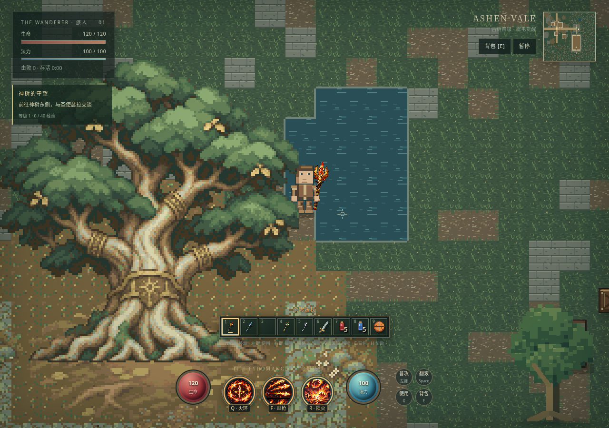
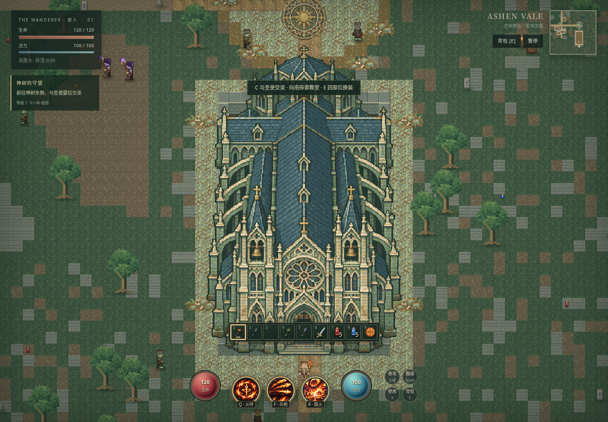
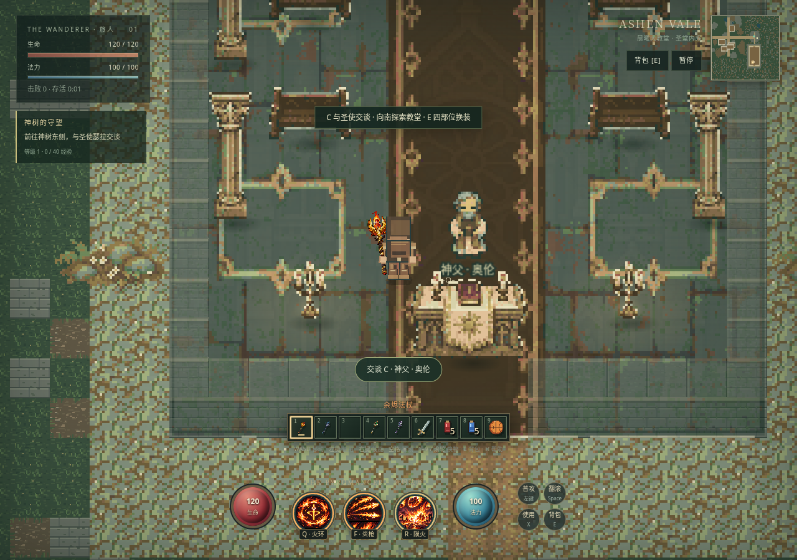
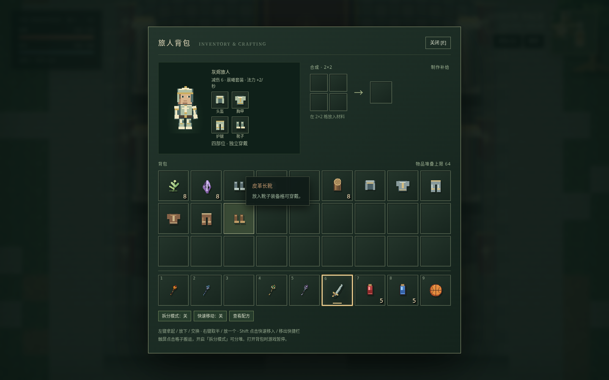

# 神树、晨曦教堂与四部位旅人

菜单「探索古树祭坛」直接到神树广场，雷电法杖仍在祭坛前。神树东侧可找到圣使瑟拉，按 C 或点「交谈」开始；交谈暂停世界与技能特效，C / Esc 或结束按钮退出。

任务流程：接受圣使的委托 → 之后击败三名亡者 → 返回圣使复命 → 沿石路向南，从教堂北门入内 → 穿过座椅间的长廊，在祭台前与神父奥伦交谈 → 领取晨曦四件套。领奖需有背包空间，满包时保留可领取状态。神父另有免费恢复生命与法力的对话。新旅途重置任务、经验和物品，沿用当前无存档约定。

击杀获得12经验，圣使复命30，神父祝福55；等级首段40、每段增加20，升级真实生命上限+6、法力上限+3。上限30级。数字在 sanctuary-data.ts。

## 地图与建筑

地图96×72，原城镇48×48保持原种子布局，去除旧东 / 南边界接缝。神树根部(1936,576)、祭坛(1936,736)、圣使(2064,800)。教堂占地从(1696,1088)到(2176,1792)，15×22格；正南门与面向神树的北门都可通行。神父(1936,1648)，祭台(1936,1728)。

屋面544×864，真实占地480×704；按最新要求重新生成哥特教堂，双钟塔、长中殿、横翼、飞扶壁、玫瑰窗与尖拱入口重像素化，内部地板及长椅 / 石柱 / 烛台 / 祭台也用同组生成图替换。内部有8张长椅、8根石柱、烛台、旗帜、地毯、彩窗投影与祭台。外墙和家具保持碰撞，中间长廊可完整走通。

外部屋面完全不透明，内部地面 / 家具 / NPC 不显示；从门洞进入后，屋顶目标透明度.035，外墙降低遮挡以看清内部。退出立即恢复屋面并隐藏内部实体。南立面外的角色按脚底进入建筑前景层，避免站在门口时被屋顶切掉头部；不会因此让屋内透明。从门槛起即进入揭顶范围，避免门洞中有一段人物消失的盲区。inCathedral 是共同内外判据；门外不能直接对话神父。普通树96×128仍由程序绘制，神树320×352与祭坛128×96按用户最新要求改为新生成原稿再重像素化；树干象牙白、金色符文、浅绿金叶。神父48×64、圣使96×112各4个站立帧，以4FPS循环。新素材先画到半尺寸，用32色地图调色板和硬透明，再最近邻放大2倍；旧树原稿仅存档。正常镜头仍桌面2、窄屏1.75，没有区域专用拉远。

## 装备扩展

InventoryState.armor 包含 head / chest / legs，boots 独立保留；装备格42 / 43 / 44 / 40，41是合成产出。开局存储格15 / 16 / 17有铁盔 / 胸甲 / 护腿，11有铁靴。点击物品再点对应装备位穿戴，不匹配的槽位拒绝并保留手持物。

四种部件材质为 none、leather、iron、sanctum；鞋另含裸足等旧材质。铁 / 晨曦头盔减伤1、胸甲2、护腿1、靴子2，总计6；皮革为外观装备。晨曦四件齐全额外回复2法力/秒，混搭无该加成。材质与统计在 armor.ts / items.ts。

block-rig.ts 生成同一套臂、手、腿、鞋姿态；世界 BlockAvatar 和背包 Canvas 共享。臂和腿仅单节，无 IK 或悬浮肢体；武器锁在持械手，不随装备偏移。步态来自实际位移；正面、背面、侧面独立，左向镜像。新增套装：加入材质 / 颜色 / 物品定义，沿用 blockSpecs 生成部件；不要复制骨架或在 UI 另画角色。

祭坛广场地板、苔草边、朝圣路、花石和太阳纹镶嵌统一重做，根部有贴地根床；删除神树 / 祭坛的旧通用椭圆阴影，树根锚点 / 碰撞不变。新材质仅烘焙显示，旧城镇、水域、墙体和教堂两扇门继续使用原碰撞地图。
