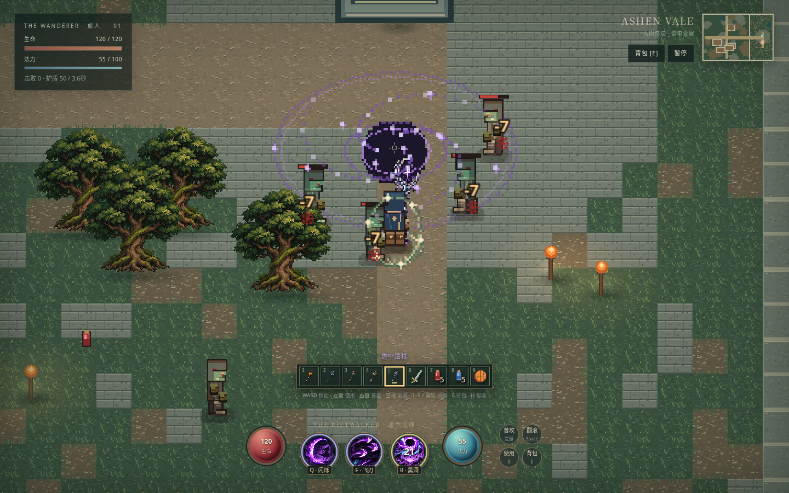
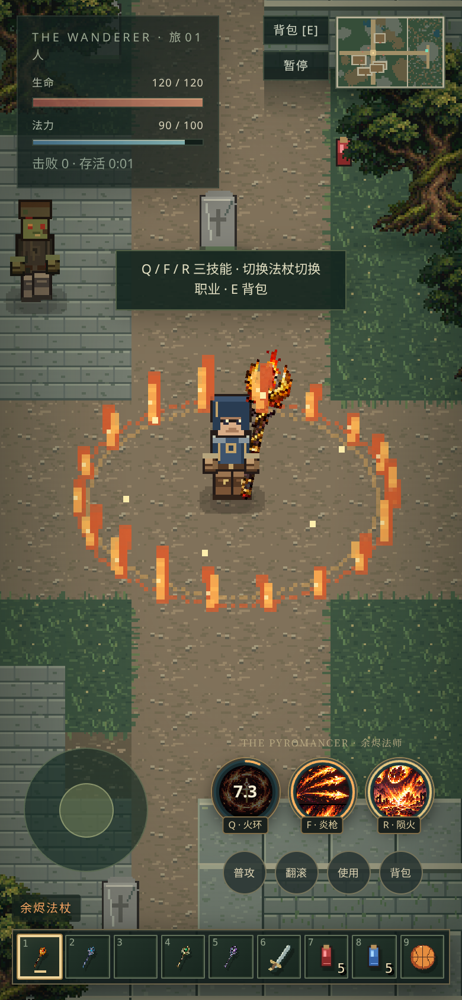

# 五系法杖 · 十五种职业技能

获得法杖后本局解锁对应职业，选中时启用三个 Q / F / R 技能。开局四根法杖已持有；雷电法杖在古树祭坛前真实拾取，第 3 格预留。换杖继续推进各自冷却，已经释放的法术会完成；新旅途重置。

| 职业 / 快捷栏 | Q | F / 右键 | R 大招 |
| --- | --- | --- | --- |
| 余烬 / 1 | 余烬护环：跟随灼烧 | 炎枪齐射：三枪穿透并点燃 | 陨火天灾：九次延迟陨火，爆炸后留下燃烧地面 |
| 霜晶 / 2 | 冰晶新星：周身冻结 | 极寒穿刺：一列穿透冰矛 | 绝冬风暴：持续五秒的暴雪与冰晶 |
| 雷电 / 3 | 环生电场：随身放电，无环绕球 | 雷霆震荡：五段向前推进 | 雷极天幕：身后连射电球，另有五球高速环绕 |
| 星辉 / 4 | 星辉护盾：吸收伤害并震击近敌 | 星轨回响：三枚分头追踪星弹 | 星辉审判：六道光柱轮替，持续伤敌，给护盾并为领域内角色回血 |
| 虚空 / 5 | 相位闪烁：遇墙停止、短暂无敌、两端震荡 | 裂隙飞刃：三刃穿透、出击与回程分别命中 | 虚空坍缩：牵引敌人、持续撕裂、最后大范围爆发 |

全部数值在 `staff-data.ts`；雷电原有模拟仍在 `mage-data.ts / systems/mage.ts`。`systems/profession.ts` 是统一输入入口与只读状态查询；`systems/staff-arts.ts` 推进其余四系的区域、弹道、陨石、灼烧。主循环在 updateMage 后执行 updateStaffArts，仍然先攻击再推进冷却，最后统一 flush。任何伤害均经 applyDamage，范围伤害检查墙体视线，弹道 4 像素分段扫掠，虚空牵引经 Level.move 解决碰撞。

界面不再有战斗区域的整体底框；三枚技能是独立圆形按钮，SVG 外圈读取真实冷却、从空补满。普攻、翻滚、使用、背包为旁边的小圆键，非职业武器另显示武技圆键。所有法杖均切换对应的三枚像素图标与中文说明，使用同一份技能数据。

祭坛与原区域使用相同镜头：桌面 zoom=2，窄屏 zoom=1.75，垂直中心跟随角色，没有林地专用缩放与前移。巨树仍按树根深度遮挡淡出，向北行走可看完整树冠。

## 新素材

`assets/source/all-staff-icons-generated.png` 为 1448×1086 原稿，四列依次余烬、霜晶、星辉、虚空，三行依次 Q / F / R。`prepare-staff-icons.cjs` 用浏览器 Canvas 最近邻裁成 256×192，小图 RGB 按 17 级距量化、透明度硬阈值。原稿不参与运行包；`staff-art.ts` 在唯一 TextureSource 创建前合入十二枚 64×64 图标，并提供程序化后备帧、炎枪和陨石。

`staff-arts-vfx.ts` 只消费标量 staffArt 事件并读取组件：地面符文与空中火焰、冰晶、光柱、旋涡分层。burst≤64、粒子≤384、拖尾跟随当前弹道清理；局部 RNG 不触碰世界 RNG，暂停不走时，重开彻底清理。没有从旧的未确认魔女 RPG 借用素材。

当前地图已继续扩为 96×72，树改为程序绘制，加入圣使与教堂任务；原五系技能规则仍保留。新人物与套装见 [SANCTUARY.md](SANCTUARY.md)。
